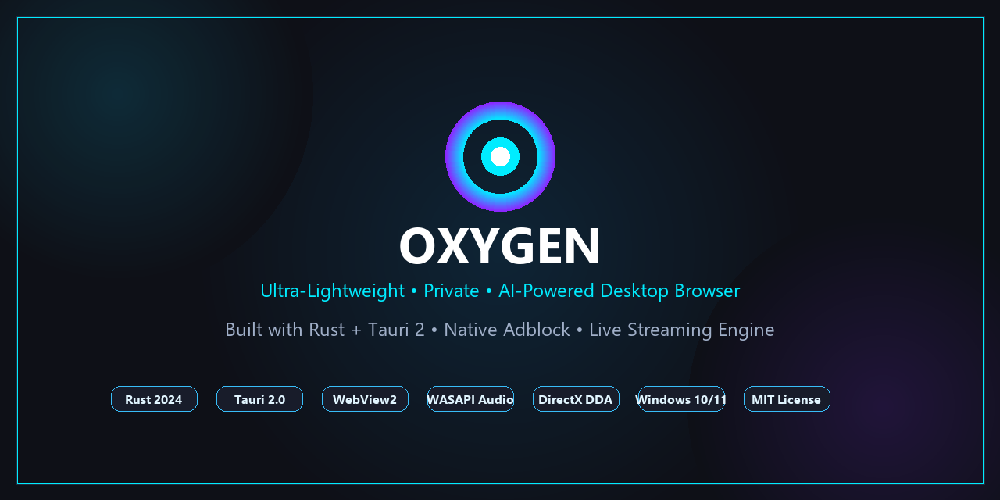
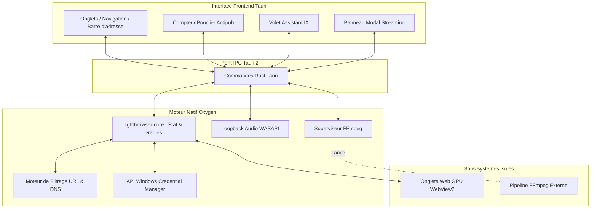

<p align="center">
  
</p>

<p align="center">
  <strong>Navigateur de bureau ultra-léger, privé et assisté par IA, conçu avec Rust et Tauri 2.</strong><br>
  <em>Bloqueur de publicités natif • Assistant IA multi-fournisseurs • Streaming en direct haute performance et Loopback audio</em>
</p>

<p align="center">
  <a href="README.md">English</a> • <a href="README.fr.md">Français</a>
</p>

<p align="center">
  <a href="https://www.rust-lang.org/"></a>
  <a href="https://v2.tauri.app/"></a>
  <a href="https://developer.microsoft.com/en-us/microsoft-edge/webview2/"></a>
  <a href="https://github.com/PapyTechnologies/Oxygen/actions/workflows/ci.yml"></a>
  <a href="https://github.com/PapyTechnologies/Oxygen/releases/tag/v0.1.0"></a>
  <a href="LICENSE"></a>
  
</p>

---

## 📸 Aperçu & Vitrine

<p align="center">
  
</p>

<!--
Captures d'écran à placer dans assets/screenshots/ :
- 01_navigation_overview.png
- 02_adblock_protection.png
- 03_ai_assistant.png
- 04_live_streaming_panel.png
- 05_downloads_manager.png
-->

> *Le guide des captures et les emplacements prévus sont détaillés dans le [Répertoire Screenshots](assets/screenshots/).*

---

## ⚡ Points Forts & Capacités Clés

- **Empreinte mémoire maîtrisée** : Conçu en Rust avec l'arborescence native des processus WebView2. Intègre une hibernation intelligente LRU des onglets inactifs et le compactage de l'espace de travail. Les utilisateurs sont invités à mesurer leurs gains de mémoire réels via le panneau de diagnostic RAM intégré.
- **Bloqueur de publicités et traqueurs natif** : Filtrage réseau des requêtes et domaines directement dans le moteur Rust, sans la surcharge d'extensions tierces lourdes.
- **Assistant IA avec coffre Windows** :
  - Clés API stockées dans le Windows Credential Manager, jamais écrites sur disque.
  - Support multi-fournisseurs : **Anthropic** (Claude), **OpenAI** (GPT-4o), **Google** (Gemini), **DeepSeek**, **OpenRouter** et **GitHub Models**.
  - Inspection de contexte transparente : le contenu d'une page n'est analysé que sur action explicite de l'utilisateur.
- **Diffusion en direct et capture vidéo intégrées** :
  - Pipeline de capture DirectX Desktop Duplication (DDA) pour une diffusion fluide et réactive.
  - Diffusion directe RTMP vers Twitch, YouTube, Kick ou des serveurs de streaming personnalisés.
  - **Loopback audio WASAPI natif** : capture le son du système et des jeux sans câble audio virtuel tiers.
  - Encodage avec accélération matérielle (NVENC, QSV, AMF) via un processus superviseur FFmpeg externe.

---

## 🖥️ Configuration Requise

| Composant | Configuration Minimale | Configuration Recommandée |
| :--- | :--- | :--- |
| **Système d'exploitation** | Windows 10 (64-bit, build 19041+) | Windows 11 (64-bit, dernière version) |
| **Moteur d'exécution** | Microsoft Edge WebView2 Evergreen | Préinstallé sur Windows 10 / 11 |
| **Mémoire RAM** | 2 Go disponibles | 4 Go ou plus |
| **Chaîne de compilation** | Rust 1.80+ (Stable) & Cargo | Rust 1.82+ |
| **Streaming en direct** | Aucun (Navigateur de base) | FFmpeg 6.0+ dans le `PATH` ou le dossier de l'app |

---

## 🚀 Guide Rapide & Compilation (5 Commandes)

Clonez et compilez Oxygen depuis les sources en cinq étapes :

```powershell
# 1. Cloner le dépôt
git clone https://github.com/PapyTechnologies/Oxygen.git

# 2. Se positionner dans le dossier du projet
cd Oxygen

# 3. Vérifier les dépendances et les ACLs de sécurité
powershell -ExecutionPolicy Bypass -File scripts/check_acl.ps1

# 4. Lancer les tests unitaires du workspace
cargo test -p lightbrowser-core

# 5. Compiler l'exécutable de production optimisé
cargo build -p lightbrowser --bin Oxygen --release
```

Le binaire optimisé se trouvera dans :
```
target\release\Oxygen.exe
```

> **Script d'installation automatisé** : Vous pouvez également exécuter `powershell -ExecutionPolicy Bypass -File scripts/setup_and_build.ps1` pour diagnostiquer automatiquement Rust, WebView2 et FFmpeg avant compilation.

---

## 📖 Utilisation Pas à Pas

### 1. Navigation Web & Gestion des Onglets
- Lancez `Oxygen.exe`.
- Ouvrez de nouveaux onglets via `Ctrl + T` ou le bouton `+` de la barre d'onglets.
- Fermez avec `Ctrl + W`. Les onglets d'arrière-plan inactifs libèrent automatiquement leur mémoire.

### 2. Bouclier Protecteur Antipub & Antitraqueur
- Le bouclier agit directement au niveau de l'interception réseau.
- Cliquez sur l'icône Bouclier dans la barre d'adresse pour consulter en temps réel le nombre de publicités, traqueurs et balises bloqués sur la page active.

### 3. Assistant IA & Coffre-Fort Windows
- Ouvrez le volet latéral IA depuis la barre d'outils.
- Choisissez votre fournisseur d'IA (Claude, GPT, Gemini, DeepSeek, etc.).
- Renseignez votre clé API : Oxygen la stocke dans le coffre sécurisé Windows (**Windows Credential Manager**) sous l'étiquette `ai-key:<fournisseur>`.
- Utilisez les actions rapides (*Résumer*, *Expliquer*, *Traduire*) pour analyser la page sans quitter votre navigation.

### 4. Diffusion en Direct (Streaming) & Enregistrement
- Ouvrez le panneau Streaming depuis la barre d'outils.
- Sélectionnez la source d'écran (DirectX DDA ou fenêtre de l'onglet actif).
- Activez le **Loopback Audio WASAPI** pour capturer le flux sonore du jeu ou du système.
- Saisissez votre URL RTMP et clé de flux (stockée également dans le coffre-fort d'identification).
- Cliquez sur **Démarrer le stream** : Oxygen lance et supervise l'encodage en tâche de fond.

---

## 🏗️ Architecture & Modèle de Sécurité



### Principes de Confidentialité & Durcissement
- **Stockage des secrets** : Les clés d'API et jetons de streaming ne sont jamais écrits en clair sur le disque ni dans des fichiers `.env`. Ils s'appuient sur l'API Windows DPAPI sécurisée.
- **Cloisonnement des processus** : Le code web tiers s'exécute dans les processus bac à sable (sandbox) de Microsoft WebView2, sans permissions d'accès direct au système de fichiers hôte.
- **Télémétrie** : Aucune collecte de données utilisateur, aucun pistage externe.

---

## 📜 Licences Tierces & Mentions Légales

Oxygen est publié sous **Licence MIT**. Il s'appuie sur les technologies suivantes :
- **Tauri 2** : Double licence MIT / Apache-2.0.
- **Microsoft Edge WebView2** : Composant propriétaire redistribuable fourni par Microsoft Corporation.
- **FFmpeg** : Outil externe autonome. Oxygen ne lie aucun code FFmpeg de manière statique ou dynamique ; il le lance comme processus externe. Les utilisateurs fournissant un binaire FFmpeg sont soumis aux licences LGPL v2.1+ ou GPL v3.0+ selon les options de compilation.
- **Listes de filtres** : Règles inspirées de listes communautaires ouvertes (EasyList, liste Peter Lowe) sous licences MPL-2.0 / GPL-3.0.
- **Marques déposées** : Toutes les marques et logos cités (YouTube, Twitch, Kick, OpenAI, Anthropic, Google, Microsoft) sont la propriété exclusive de leurs détenteurs respectifs.

Consultez [THIRD_PARTY_NOTICES.md](THIRD_PARTY_NOTICES.md) pour les détails et liens amonts.

---

## 🗺️ Feuille de Route (Roadmap)

- [x] Architecture multi-onglets avec moteur WebView2 Evergreen
- [x] Filtrage réseau antipub et antitraqueur natif
- [x] Assistant IA multi-fournisseurs avec stockage dans le coffre Windows
- [x] Capture audio loopback WASAPI native
- [x] Superviseur de streaming direct RTMP
- [ ] Encodage matériel direct via bindings Rust NVENC / AMF (sans dépendance FFmpeg)
- [ ] Injecteur de scripts et styles utilisateur personnalisés
- [ ] Synchronisation des favoris avec chiffrement côté client (Zero-Knowledge)
- [ ] Cibles de compilation multiplateformes Linux (WebKitGTK) et macOS (WebKit)

---

## 🤝 Contribution

Les retours, signalements de bogues et contributions sont les bienvenus ! Veuillez consulter [CONTRIBUTING.md](CONTRIBUTING.md) et nos règles de sécurité dans [SECURITY.md](SECURITY.md) avant de soumettre une pull request.

---

## 💖 Soutien & Dons

Oxygen est un projet open-source indépendant développé pour offrir une navigation rapide, privée et accessible à tous les ordinateurs. Si Oxygen vous est utile, vous pouvez soutenir son développement :

- **PayPal** : [Faire un don via PayPal](https://www.paypal.com/ncp/payment/3NNHCJQX4QUN4)
- **Ko-fi** : [Soutenir sur Ko-fi](https://ko-fi.com/papytech)
- **GitHub** : Mettre une étoile et suivre [PapyTechnologies](https://github.com/PapyTechnologies)

---

## 📄 Licence

Distribué sous la **Licence MIT**. Consultez [LICENSE](LICENSE) pour plus d'informations.
