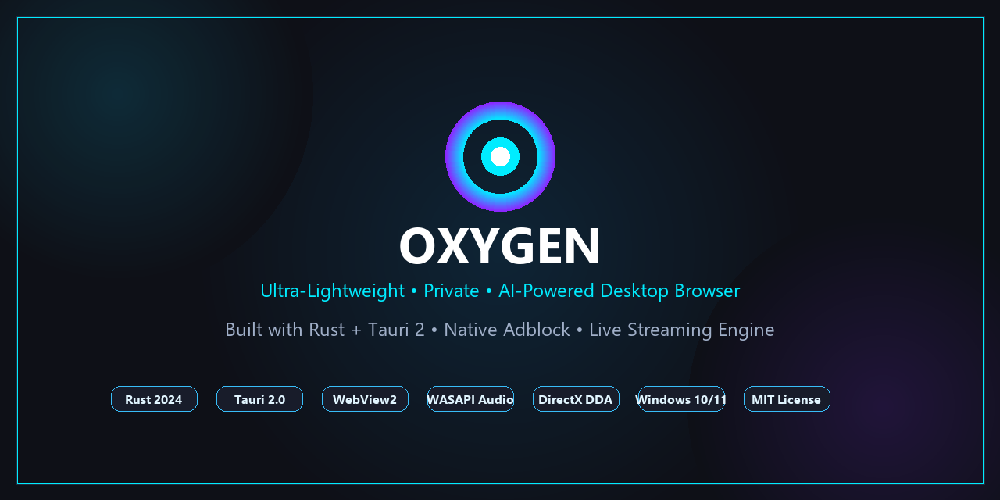
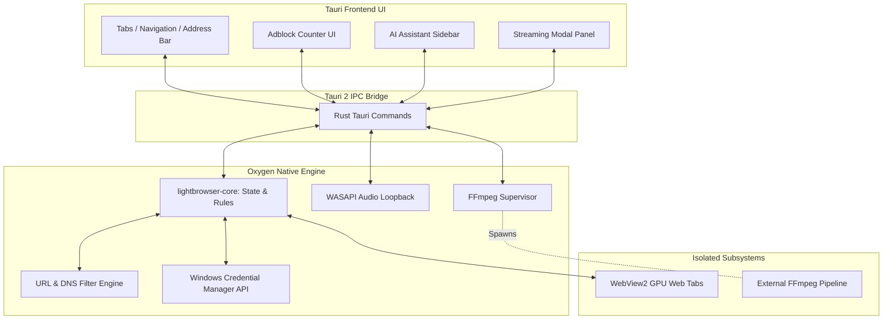

<p align="center">
  
</p>

<p align="center">
  <strong>Ultra-lightweight, private, and AI-powered desktop browser built with Rust and Tauri 2.</strong><br>
  <em>Native Adblocker • Multi-Provider AI Assistant • High-Performance Live Streaming & Audio Loopback</em>
</p>

<p align="center">
  <a href="README.md">English</a> • <a href="README.fr.md">Français</a>
</p>

<p align="center">
  <a href="https://www.rust-lang.org/"></a>
  <a href="https://v2.tauri.app/"></a>
  <a href="https://developer.microsoft.com/en-us/microsoft-edge/webview2/"></a>
  <a href="https://github.com/PapyTechnologies/Oxygen/actions/workflows/ci.yml"></a>
  <a href="https://github.com/PapyTechnologies/Oxygen/releases/tag/v0.1.0"></a>
  <a href="LICENSE"></a>
  
</p>

---

## 📸 Showcase

<p align="center">
  
</p>

---

## ⚡ Highlights & Key Capabilities

- **Lean Memory Footprint**: Engineered with Rust and native WebView2 process trees. Features active LRU tab hibernation and working-set compaction to conserve memory across workloads. Users can inspect their real-time memory usage directly via the browser's built-in RAM diagnostic panel.
- **Native Ad & Tracker Blocker**: In-engine URL and domain rule matching inspired by EasyList patterns without the overhead of heavy third-party extensions.
- **AI Assistant with Windows Credential Vault**:
  - API keys stored in the Windows Credential Manager, never written to disk.
  - Multi-provider support: **Anthropic** (Claude), **OpenAI** (GPT-4o), **Google** (Gemini), **DeepSeek**, **OpenRouter**, and **GitHub Models**.
  - Transparent opt-in context inspection: page contents are only analyzed upon explicit user trigger.
- **Integrated Live Broadcasting & Screen Capture**:
  - DirectX Desktop Duplication (DDA) screen capture pipeline for responsive streaming.
  - Direct RTMP broadcasting to Twitch, YouTube, Kick, or custom streaming ingest servers.
  - Native **WASAPI system audio loopback**: captures desktop sound directly without third-party virtual audio cables.
  - Hardware-accelerated encoding options (NVENC, QSV, AMF) via supervisor-managed external FFmpeg processes.

---

## 🖥️ System Requirements

| Component | Minimum Requirement | Recommended |
| :--- | :--- | :--- |
| **Operating System** | Windows 10 (64-bit, build 19041+) | Windows 11 (64-bit, latest release) |
| **Runtime** | Microsoft Edge WebView2 Evergreen | Pre-installed on Windows 10 / 11 |
| **RAM** | 2 GB Available | 4 GB+ |
| **Build Toolchain** | Rust 1.80+ (Stable) & Cargo | Rust 1.82+ |
| **Live Streaming** | None (Core browser) | FFmpeg 6.0+ on `PATH` or in application folder |

---

## 🚀 Quickstart & Installation (5 Commands)

Clone and compile Oxygen from source in five straightforward steps:

```powershell
# 1. Clone the repository
git clone https://github.com/PapyTechnologies/Oxygen.git

# 2. Navigate to the project directory
cd Oxygen

# 3. Verify toolchain dependencies and security ACLs
powershell -ExecutionPolicy Bypass -File scripts/check_acl.ps1

# 4. Run automated workspace unit tests
cargo test -p lightbrowser-core

# 5. Compile the optimized release binary
cargo build -p lightbrowser --bin Oxygen --release
```

The resulting optimized executable will be located at:
```
target\release\Oxygen.exe
```

> **Automated Setup Script**: You can also run `powershell -ExecutionPolicy Bypass -File scripts/setup_and_build.ps1` to automatically inspect Rust, WebView2, and FFmpeg before compiling.

---

## 📖 Step-by-Step Usage

### 1. Web Navigation & Tab Management
- Launch `Oxygen.exe`.
- Open tabs using `Ctrl + T` or the `+` button on the tab bar.
- Use `Ctrl + W` to close tabs. Inactive background tabs are automatically trimmed to conserve RAM.

### 2. Shield & Tracker Blocker
- The integrated shield operates natively at network interception level.
- Click the Shield icon in the address bar to view the real-time count of blocked ads, analytics beacons, and trackers on the active page.

### 3. AI Assistant & Credential Vault
- Open the AI panel via the sidebar button or shortcut.
- Select your preferred model provider (Claude, GPT, Gemini, DeepSeek, etc.).
- When prompted for an API key, enter it once. Oxygen delegates storage to the **Windows Credential Manager** under target identifier `ai-key:<provider>`.
- Use the contextual action buttons (*Summarize*, *Explain*, *Translate*) to query the active page without leaving your workflow.

### 4. Live Streaming & Recording
- Open the Streaming panel from the toolbar.
- Choose your video input source (Display capture via DirectX DDA or active tab window).
- Enable **WASAPI Audio Loopback** to capture game/system sound directly.
- Enter your RTMP URL and Stream Key (stream keys are also isolated in the Windows Credential Vault).
- Click **Start Stream**. Oxygen spawns and supervises the background encoding pipeline.

---

## 🏗️ Architecture & Security Model



### Privacy & Hardening Principles
- **Credential Storage**: API secrets and streaming tokens are never persisted in plaintext, `.env` files, or configuration databases. They interface directly with Windows DPAPI-protected Credential Store.
- **Process Sandboxing**: Untrusted web pages render inside Microsoft WebView2 sandboxed utility processes without direct filesystem access to your system.
- **Telemetry**: Oxygen does not collect or send usage data. Network requests are made only to the AI provider or streaming endpoint you configure, and to the sites you visit.

---

## 📜 Third-Party Licenses & Disclaimers

Oxygen is distributed under the **MIT License**. It interfaces with and acknowledges the following technologies:
- **Tauri 2**: Dual-licensed MIT / Apache-2.0.
- **Microsoft Edge WebView2**: Proprietary redistributable runtime provided by Microsoft Corporation.
- **FFmpeg**: Standalone external tool. Oxygen does not statically or dynamically link FFmpeg code; it launches it as an external sub-process. Users providing FFmpeg binaries are subject to LGPL v2.1+ or GPL v3.0+ terms depending on compile flags (e.g. `--enable-gpl`, `--enable-libx264`).
- **Filter Lists**: Adblock rules are inspired by open community lists (EasyList, Peter Lowe's ad server list) distributed under MPL-2.0 / GPL-3.0.
- **Trademarks**: All trademarks and logos (YouTube, Twitch, Kick, OpenAI, Anthropic, Google, Microsoft) belong to their respective copyright holders.

See [THIRD_PARTY_NOTICES.md](THIRD_PARTY_NOTICES.md) for full notices and upstream links.

---

## 🗺️ Roadmap

- [x] Multi-tab architecture with WebView2 Evergreen backend
- [x] Built-in ad & tracking network filter
- [x] Multi-provider AI assistant with Windows Credential Vault storage
- [x] WASAPI system sound loopback capture
- [x] Live RTMP streaming supervisor
- [ ] Direct hardware encoding via NVENC / AMF Rust bindings (zero-FFmpeg fallback)
- [ ] Custom user script & style injector
- [ ] Bookmark synchronization with client-side zero-knowledge encryption
- [ ] Linux (WebKitGTK) and macOS (WebKit) cross-platform compilation targets

---

## 🤝 Contributing

We welcome community feedback, issue reports, and pull requests! Please read our [CONTRIBUTING.md](CONTRIBUTING.md) and review our [SECURITY.md](SECURITY.md) guidelines before opening a pull request.

---

## 💖 Support & Donations

Oxygen is an independent open-source initiative created to keep desktop web browsing lean, private, and powerful. If you find Oxygen helpful, support its maintenance:

- **PayPal**: [Donate via PayPal](https://www.paypal.com/ncp/payment/3NNHCJQX4QUN4)
- **Ko-fi**: [Support on Ko-fi](https://ko-fi.com/papytech)
- **GitHub**: Star and follow [PapyTechnologies](https://github.com/PapyTechnologies)

---

## 📄 License

Distributed under the **MIT License**. See [LICENSE](LICENSE) for details.
