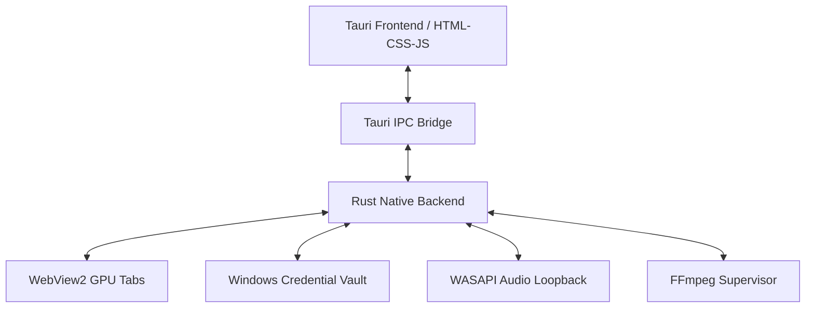

# Oxygen Browser

> **Breathe the Web** — Ultra-lightweight, private, and AI-assisted browser built for speed and resource efficiency.

[](https://github.com/PapyTechnologies/Oxygen/actions)
[](LICENSE)
[](https://www.paypal.com/ncp/payment/3NNHCJQX4QUN4)
[](https://ko-fi.com/papytech)

Oxygen is an ultra-fast desktop web browser engineered in **Rust** and **Tauri 2**, leveraging native **WebView2** hardware-accelerated rendering. It is designed from the ground up for modest and high-end PCs alike, keeping memory footprints low while integrating privacy features, streaming tools, and an AI copilot.

---

## Key Features

- **Blazing Fast & Low Footprint**: Built in Rust with native WebView2 child process trees, strict LRU tab memory unloading, and private working-set tracking.
- **Built-in Ad & Tracker Blocker**: Fast in-engine URL matching without bloated third-party extension overhead.
- **Secure AI Assistant**:
  - Connects to Anthropic, OpenAI, Google Gemini, DeepSeek, OpenRouter, and GitHub Models.
  - Transparent opt-in consent: page text is only inspected on explicit click.
  - API keys are stored exclusively in the Windows Credential Manager vault—never saved to disk files or transmitted without user instruction.
- **Integrated Live Streaming & Recording**:
  - Direct live broadcasting to Twitch, YouTube, Kick, and custom RTMP endpoints.
  - Native WASAPI system sound loopback capture without needing virtual audio cables.
  - Hardware-accelerated encoding (NVENC, QSV, AMF) via supervisor-managed external FFmpeg pipelines.

---

## Architecture & Security Model



### Privacy & Credentials Discipline
- **Zero Local Key Leakage**: API tokens and stream keys are placed directly into the Windows Credential Vault (`ai-key:<provider>` / `stream-key:<service>`).
- **Isolation**: Remote web content runs in sandboxed WebView2 child processes without direct host filesystem permissions.

---

## Building from Source

### Prerequisites
1. **Rust 1.80+**: Installed via [rustup.rs](https://rustup.rs/).
2. **Microsoft Edge WebView2**: Pre-installed on Windows 10 & 11.
3. **FFmpeg** *(Optional, for live streaming)*: Available on system `PATH` or next to the executable.

### Compilation Steps

```powershell
# Clone the repository
git clone https://github.com/PapyTechnologies/Oxygen.git
cd Oxygen

# Run automated tests
cargo test -p lightbrowser-core

# Build release executable
cargo build -p lightbrowser --bin Oxygen --release
```

The resulting binary is created at `target/release/Oxygen.exe`.

---

## Support & Donations

Oxygen is an independent open-source project dedicated to keeping web browsing fast, private, and accessible on every PC. If you find Oxygen valuable, your support helps maintain continuous development, test hardware compatibility, and build new features!

- **PayPal**: [Donate via PayPal](https://www.paypal.com/ncp/payment/3NNHCJQX4QUN4)
- **Ko-fi**: [Support on Ko-fi](https://ko-fi.com/papytech)
- **GitHub**: Star and follow [PapyTechnologies](https://github.com/PapyTechnologies)

Every contribution and star is deeply appreciated!

---

## Contributing

Contributions are welcome! Please read [CONTRIBUTING.md](CONTRIBUTING.md) and [SECURITY.md](SECURITY.md) before opening a pull request.

---

## License

This project is licensed under the [MIT License](LICENSE).
See [THIRD_PARTY_NOTICES.md](THIRD_PARTY_NOTICES.md) for details on third-party libraries and tools.
